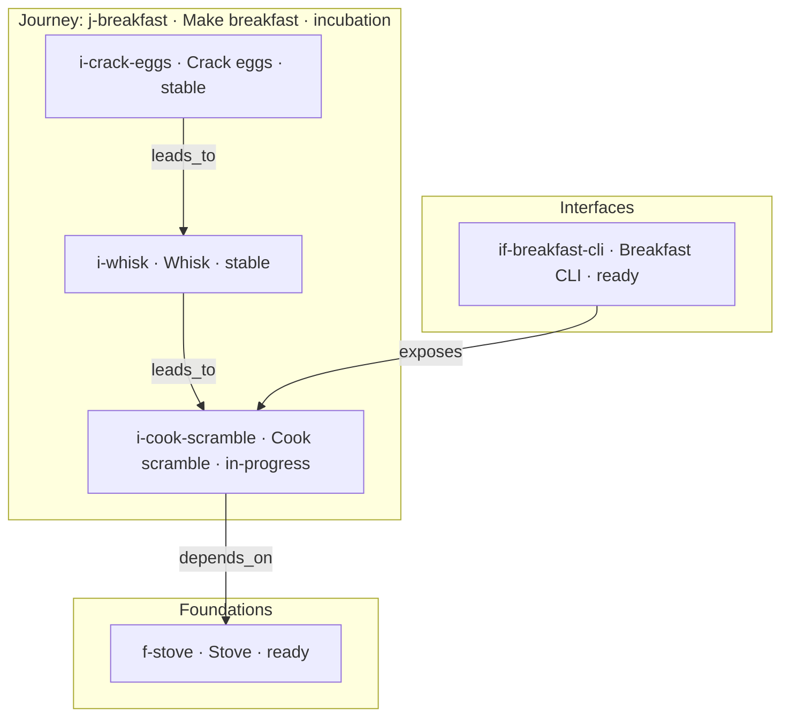

# MindPlan

**Everything works great until it doesn’t. MindPlan draws the boundaries your agent won’t.**

Without them you get a 5,000-line app file; MindPlan keeps your product’s structure in git and rejects any agent move that crosses it.

## In plain words

MindPlan names five kinds of thing. Type names stay for the graph and tools; plain words help humans and agents talk about them:

| Type | Plain word | Question | Example |
|------|------------|----------|---------|
| **Journey** | area | What does the product do? | Billing |
| **Interaction** | action | What can someone do? | Split the check |
| **Interface** | entry point | Where do they do it? | Checkout page, CLI, MCP tools |
| **Foundation** | building block | What does it all run on? | Database, design system, Stripe |
| **Bug** | bug | What's broken? | Double charge on split |

Links in plain words: `belongs_to` = is part of · `exposes` = shows · `depends_on` = needs · `leads_to` = then goes to · `affects` = breaks.

Rules in plain words: **Infrastructure First** — build the building blocks before the action that needs them. **Behavior First** — an action has to work before you put it on a page. **Completion Check** — finish the checklist before going live. **No Ghosts** — every action lives in an area and stands on a building block.

## Think in systems

Orient on the graph. Place each change on it. Respect the edges. Claim files. Classify shipped work by blast radius. That dialect plus this project's brief load through `get_project`. Before each action, call `get_rules` then `orient_for_work`. Before new-feature code, update or create nodes with the `plan-project` skill.

Without those boundaries, agents improvise from chat and tickets. The compiler refuses the illegal move:

```
Blocked: Infrastructure First. Interaction "i-checkout" cannot ship while
linked Foundations are not stable: "f-payments" (in-progress).
```

## Plans are made to be changed

The compiler refuses *illegal* moves; it does not freeze the plan.

- **Rewire** — `link_nodes` / `unlink_nodes` (`belongs_to`, `depends_on`, `exposes`, `leads_to`, `affects`, `mounts`)
- **Retreat** — `in-review` → `in-progress` when scope or checklist reality changes
- **Evolve** — shipped Foundations/Interactions/Interfaces keep the same id; `open_next` writes `<id>.next.mdx` from the live file → build → `ship` promotes it over `<id>.mdx` and deletes it, so a shipped node is one file
- **Revise together** — classify the blast radius. Sources get a full successor (`open_next`). Neighbors whose files changed but whose behavior did not are edited in place, with no `next` and no impact note. Nodes whose files did not change are left alone. Status then moves Foundations, then Interactions, then Interfaces, then Bugs, in one call, and stops on the first `Blocked:`
- **Ship after green check** — the implementer `ship`s when `run_check` (the CLI `mindplan-mcp check`) is green and legal transitions allow; moves to `in-review` and `ship` also run its import and ownership rules on the node's files, and `update_node_status` with `scope` walks every open update (or one change's revisions) through in-review to ship in one call — jumping past in-review needs `skip_review: true`, which is reported
- **Decide on the record** — when an agent chooses between viable designs, `record_decision` keeps the choice, the rejected alternative, and the reason on the node; the next agent gets it from `orient_for_work` before touching that design. A shipped Foundation's revision, a new migration, a wide blast radius, or a `depends_on` change cannot reach `in-review` without one
- **Retire** — production work to `deprecated` when intent is replaced (Journeys stay; only Bugs truly close)

## See what the agent sees

After every graph mutation, MindPlan refreshes [`mindplan/map.md`](mindplan/map.md) — Journeys, Interactions, Interfaces, Foundations, and Bugs. On demand: MCP `export_mindplan_view` or CLI `mindplan-mcp view`.

Today's map is an **architecture + state** projection. A richer status board is planned.

## Worked example: scrambled eggs

An **area** (make breakfast), a **building block** (the stove), **actions** (crack, whisk, cook), and an **entry point** (the breakfast CLI):



- **Journey** `j-breakfast` — area: permanent capability (make breakfast)
- **Foundation** `f-stove` — building block; cook cannot ship until the stove is `stable`
- **Interactions** — actions (crack, whisk, cook); they share state via Foundations, never `depends_on` each other. `leads_to` is "then goes to" only (cycles allowed, not a ship gate)
- **Interface** `if-breakfast-cli` — entry point: how an actor starts cooking; ship needs exposed Interactions `stable` (**Behavior First**)

```
Blocked: Infrastructure First. Interaction "i-cook-scramble" cannot ship while
linked Foundations are not stable: "f-stove" (ready).
```

In plain words: you cannot go live with *cook scramble* while the *stove* building block is still only ready to build, not live.

## How it's built

Territory under `mindplan/` (Journeys, Foundations, Interactions, Interfaces, Bugs) plus optional `<id>.next.mdx` while a shipped node evolves. Nodes declare owned source files via `implements` / `set_implementation_files` (`mindplan/config.json` `sources`/`exclude` define the coverage universe). An MCP server is the single write path for server-owned frontmatter.

- **[SPEC.md](SPEC.md)** — graph, compiler rules, and tools
- **`src/`** — TypeScript MCP server (stdio)

## This repo's live plan

This repository dogfoods MindPlan. Live territory: [`mindplan/`](mindplan/). Map: [mindplan/map.md](mindplan/map.md).

## Who is this for

Built for people who ship **with AI agents** and need a living product architecture, not a stale ticket list. Best for indie developers and small teams where plan state is plain-text in git. Poor fit today for orgs that need multi-user permissions, audit trails, or sync with Jira/Linear.

## Quick start

Requires Node.js 22.13 or later (the first 22.x release with `node:sqlite` unflagged, which the search cache uses). No clone or build step: the package ships `dist/` and the agent templates.

1. Install it.

   - **A project with a `package.json`:** add it as a dev dependency so the lockfile pins the version for everyone, CI, and containers:

     ```bash
     npm install -D mindplan-mcp
     ```

   - **Any other project** (Python, Go, …): nothing to install; use `npx -y mindplan-mcp@0.13` (a version range) in the config below.

2. Register the MCP server. It runs over stdio, so the host starts it from the project root. For Claude Code, run `claude mcp add mindplan -- npx mindplan-mcp`, or commit a `.mcp.json` so everyone who opens the repo gets it (the package ships the same snippet as `templates/agent/mcp.json.example`; Cursor reads it from `.cursor/mcp.json`):

```json
{
  "mcpServers": {
    "mindplan": { "type": "stdio", "command": "npx", "args": ["mindplan-mcp"] }
  }
}
```

With a dev dependency, `npx mindplan-mcp` runs the locked copy from `node_modules/.bin` (run `npm install` first in a fresh container). Without one, use `"args": ["-y", "mindplan-mcp@0.13"]`. Other hosts: [templates/agent/integrations/README.md](templates/agent/integrations/README.md). Reload MCP servers after config changes.

3. Ask your agent to **set up MindPlan**. It calls the `setup_project` tool, which creates `mindplan/` (a default `config.json` with `sources: ["src/**"]`, an empty `project.md` from `templates/agent/project.md`, and the `version.json` stamp) and returns a guide plus `pointer`, the short instructions every session must see first. Following the guide, the agent writes the pointer to `MINDPLAN.md` at the root and wires it into the files your agent reads (`@MINDPLAN.md` in `CLAUDE.md`, a line in `AGENTS.md`, or the host's rules file), adds `.mindplan-cache/` to `.gitignore` (and `mindplan/**` to `.cursorignore` for Cursor), proposes moving your existing standing rules into the project brief, asks for a product description, and offers the [merge gate](#merge-gate). The server never writes those repository files itself; the agent shows you each change. The skills (`plan-project`, `define-entities`) are served by the server through `get_skill`, so nothing is copied into `.claude/` or `.cursor/`.

### Upgrading

Bump the package (`npm update mindplan-mcp`, Dependabot, or a new `npx` range) and reload the MCP server. `mindplan/version.json` is `{ package, graph, migrations }`: `migrations` is the graph migration level it was last brought to. A release that adds a graph migration raises the server's level; a release that adds none needs no upgrade step. While the stamp is below the server's level (or missing: graphs stamped by the removed `init` command read as level 0), every graph tool answers `Blocked: Version`, `get_project` returns a `version` field naming the fix, and `mindplan-mcp check` fails. Ask your agent to upgrade MindPlan: it calls `upgrade_project`, which runs every migration (all idempotent), stamps the new level, and returns a guide. The agent then deletes the old host copies it reports as `leftovers` (`.claude/skills/mindplan-*`, `.cursor/skills/mindplan-*`, `.cursor/rules/mindplan.mdc`), refreshes `MINDPLAN.md` when `pointer_outdated`, and commits the upgrade on its own. A stamp newer than the server (a teammate upgraded, you did not) blocks too, until you upgrade `mindplan-mcp`. Read [CHANGELOG.md](CHANGELOG.md) for breaking changes before upgrading across a minor version while on 0.x.

### From source (contributors)

```bash
git clone https://github.com/nbiro/mindplan.git
cd mindplan
npm install && npm run build
```

Then register `node /absolute/path/to/mindplan/dist/index.js` (with `MINDPLAN_ROOT` set to your project root) as the MCP server command instead of `npx mindplan-mcp`.

## File system layout (consumer project)

```
<project-root>/
├── .mindplan-cache/               # derived graph and search caches (gitignored, safe to delete)
├── mindplan/
│   ├── config.json                # { sources, exclude } — coverage universe; optional decisions, search
│   ├── project.md                 # description + rules only (playbook via get_project)
│   ├── version.json               # { package, graph, migrations } — written by setup_project / upgrade_project; drives the version gate
│   ├── journeys/<id>/<id>.mdx
│   ├── foundations/<id>/<id>.mdx  # + optional <id>.next.mdx
│   ├── interactions/<id>/<id>.mdx # + optional <id>.next.mdx
│   ├── interfaces/<id>/<id>.mdx   # + optional <id>.next.mdx
│   └── bugs/<id>/<id>.mdx
└── …                              # app code wherever implements claims it
```

Owned files are declared with `set_implementation_files` (exact paths or directories ending in `/`) under the `sources`/`exclude` universe — there is no prescribed `src/<type>/<id>/` tree. This repo dogfoods that shape; consumers need not. Edge arrays in frontmatter: `belongs_to`, `depends_on`, `exposes`, `leads_to`, `affects`. See SPEC.md §1–§2.

## Taxonomy

| Type | What it is | States |
|------|------------|--------|
| **Journey** | Domain capability the architecture screams | Computed (`draft`, `incubation`, `stable`, `evolving`) |
| **Interaction** | Self-contained behavior (any actor) — **not** an entry surface; owns domain + mountable view/handler | Build pipeline + `stable`/`unstable` |
| **Interface** | How an actor enters an Interaction (Page, CLI, MCP, Webhook, Cron, …) — **mounts/wires only** | Build pipeline + `stable`/`unstable` |
| **Foundation** | Shared substrate by role (Assembler, Infra, Design system, Adapter) | Build pipeline + `stable`/`unstable` |
| **Bug** | Defect on Interaction, Interface, or Foundation | `open → triaged → fixing → in-review → resolved \| wontfix` |

Journeys scream the domain · Interactions are behaviors (they own the screen body / handler) · Interfaces are entry (they only mount) · Foundations are shared substrate · Assembler composes them.

**Build pipeline** (Foundation/Interaction/Interface): `draft → ready → in-progress → in-review → ship` → computed `stable`/`unstable`.

## Compiler Rules

Every violation starts with `Blocked: `.

1. **No Ghost Interactions** — need `belongs_to` + Foundation `depends_on` before `ready`/`in-progress`
2. **No Ghost Interfaces** — need `exposes` before `ready`/`in-progress`
3. **No Ghost Bugs** — need `affects` before `triaged`/`fixing`
4. **Infrastructure First** — Interaction `ship` needs all Foundation deps `stable`
5. **Behavior First** — Interface `ship` needs all exposed Interactions (and Foundation deps) `stable`
6. **Completion Check** — unchecked `[ ]` block `ship` (and Bug `resolved`)
7. **Interaction Independence** — no Interaction → Interaction `depends_on` (share state via Foundations)
8. **Computed Journeys / Stability** — never set manually
9. **Taxonomy** — legal edge shapes; `depends_on` acyclic; `leads_to` cycles allowed
10. **Next Evolution / Force Unship** — stable-id `open_next`; recovery only with explicit `confirm`

No Dependency Closure / `link_dependent`.

## Graph cache

Every tool call loads the graph. Parsing every `.mdx` file costs about a millisecond per node, so the server keeps parsed records in `.mindplan-cache/graph.db` (and in memory) and re-parses only node folders that changed. In a git repository with 1,000 or more nodes, git status and the plan's tree id tell it which folders are clean and committed, and those are reused without touching their files. Elsewhere it compares each file's size and modification time, and hashes files modified in the last two seconds. On 10,000 nodes (Windows) a load takes 0.4 s with git and 1.1 s by file stamps, against 9.4 s without the cache; the first load after an upgrade costs about 30% more than an uncached one. The cache is derived from the `.mdx` files, gitignored, and safe to delete; `MINDPLAN_GRAPH_CACHE=off` turns it off for one process. See [SPEC.md §1.1.3](SPEC.md#113-graph-cache-mindplan-cachegraphdb).

## Search

`find_related_nodes` and `orient_for_work` rank nodes with hybrid search: keyword (SQLite FTS5) and semantic (a small local embedding model) results merged by reciprocal rank fusion, plus a small boost for nodes linked to the best matches. An exact id always ranks first, and a file path ranks the node that claims it. A query saying "quote" can find a node that says "enquiry".

- **The cache.** `.mindplan-cache/index.db` at the project root is derived from the `.mdx` files, which stay the only source of truth. It is gitignored, re-synced on every search (so a `git pull` or branch switch is picked up on the next call), and safe to delete at any time.
- **The model.** `Xenova/bge-small-en-v1.5` (English, about 30 MB) runs locally through [transformers.js](https://huggingface.co/docs/transformers.js), an optional dependency: no API key, nothing leaves the machine. It downloads once per machine into `~/.cache/mindplan/models` (override with `MINDPLAN_MODEL_CACHE`) in the background when the server starts; a tool call never waits for it.
- **Fallback.** Until the model is ready, or when it cannot load (offline, a proxy, a sandbox, `npm install --omit=optional`), search is keyword-only and never fails; the reason is logged once to stderr. On a runtime without `node:sqlite` or FTS5 (Node 22.13's bundled SQLite has no FTS5) the keyword half runs the same BM25 in plain JS, which ranks the search test set as well as FTS5 does.
- **Settings.** `patch_config({ search: { enabled: false } })` turns semantic ranking off; `patch_config({ search: { model: "Xenova/all-MiniLM-L6-v2" } })` picks another model (the cache rebuilds). `MINDPLAN_SEARCH=keyword` turns it off for one process, and `MINDPLAN_SEARCH_OFFLINE=1` uses only an already-downloaded model.

## MCP Tools

The descriptions the MCP server sends to clients — each tool's `description` and each argument's `.describe()` — are defined in each action's `tools.ts` under [`src/interactions/`](src/interactions/) and mounted by [`src/interfaces/if-mcp-tools/register.ts`](src/interfaces/if-mcp-tools/register.ts). Inputs, outputs, effects, and errors are specified in [SPEC.md §8](SPEC.md#8-mcp-tool-contract). Every tool carries MCP annotations derived from its kind (`readOnlyHint` on read tools, `destructiveHint` on `unlink_nodes`, `remove_attachment`, `discard_next`, and `force_unship`; `openWorldHint` always false), so a host can auto-approve reads and prompt on destructive calls. The server has 33 tools. Every tool except `get_project`, `get_rules`, `get_spec`, `get_skill`, `run_check`, `setup_project`, and `upgrade_project` is gated on the graph version: with no `mindplan/` it answers `Blocked: Version` naming `setup_project`, with a stamp below the server's migration level it names `upgrade_project`, and with a stamp or graph newer than the server it asks you to upgrade `mindplan-mcp` (see [Upgrading](#upgrading)). Results are compact JSON text plus `structuredContent`. Results that grow with the graph stay under the host's size limit: `get_mindplan_graph` pages (`offset` / `limit`, `next_offset`), and `export_mindplan_view` refuses a diagram over 80,000 characters unless you pass `focus` or `output`.

| Tool | Kind | Description |
|------|------|-------------|
| `orient_for_work` | read | Summary first: a query returns ranked rows (the full node only for a clear winner, `auto_focus`); `change` orients on every member of a change at once; `node_id` returns `record`/`body` context, `shape`, owned files, blast radius (grouped files; retired omitted; Interaction focus includes `reachability`), and `stability` (direct fan-in, recent ship rate against the project's median, hotspot); writes on a node wait until it was oriented on (`Blocked: Orientation`); the `rules` that apply to the focus and its own `decisions` (inherited ones counted in `inherited_decisions`, listed with `include_inherited_decisions`); `depth: rules\|body\|full` trims it; the body is the active slot's (the open revision's while one is open), `slot` picks one, `section` returns one section; the `decisions` block is the reply's only copy |
| `get_rules` | read | The mandatory project rules with a `rules_version` tag; `known_version` returns `{ unchanged: true }` without the text when nothing changed |
| `run_check` | read | The same integrity check as `mindplan-mcp check` (`ok`, `output`, `failures`, `warnings`, `info`); unclaimed files and illegal imports come with their fix; `hotspot:` warnings name shipped nodes that ship far more often than the project's median; `change` also gates every member of a change (revisions and labeled neighbors) and prints its additivity; `merge` (`true` or `"strict"`) runs the merge gate |
| `get_spec` | read | One section of the running server's own SPEC.md by stable topic id (`territory-shape`, `lifecycle`, `change-ids`, `neighbors`, `decisions`, …) or tool name; no topic lists them |
| `get_skill` | read | The skills this server serves (`plan-project`, `define-entities`): no name lists them with their description and files; `name` returns the SKILL.md text without frontmatter; `name` + `file` returns one supporting file |
| `list_areas` | read | Every Journey (area) as one row: id, title, short description, and counts of its Interactions, Interfaces, Foundations, and open Bugs; pass a row's id as `area` to `orient_for_work` / `find_related_nodes` |
| `find_related_nodes` | read | Hybrid search by query (keyword + semantic; exact id first); focus + 1-hop |
| `get_mindplan_graph` | read | One page of assembled nodes/edges (`version: 1`): `offset` / `limit` (default 200), totals, `next_offset` |
| `export_mindplan_view` | read | Mermaid or DOT; `decisions: true` labels decision counts; `output` writes to a file; over-budget diagrams are Blocked with the fix |
| `list_decisions` | read | Decision records of a node, a change, or the graph; superseded ones on request |
| `get_blast_radius` | read | Reverse-`depends_on` affected + grouped `affected_files` for a node or a whole `change` (with `additivity`: new nodes vs reopened shipped ones); cancelled/deprecated omitted unless `include_retired`; the focus's decisions plus `dependent_decisions` (rows with `include_dependent_decisions`) |
| `get_node_context` | read | `record` + `body` + its own `decisions` (superseded only with `include_superseded`; + `next.record`/`next.body`/`next.decisions` when evolving; `slot` returns one slot, `section` one section of each body) + `inherited_decisions` (count and nodes; entries with `include_inherited_decisions`) |
| `get_node_implementation` | read | Owned files for a node, or path → owner lookup |
| `set_implementation_files` | mutation | Set `implements` claims (files or directories ending in `/`); on a shipped node, adds a claim in place when it only grows into folders the node alone owns; `change` labels a neighbor; `attributed` names files a revision adds in another node's folder (a migration in the root's migrations folder), counted by the decision gate |
| `set_test_files` | mutation | Link the test files (paths, directories ending in `/`, or globs) that verify a node; evidence, not a claim, written to live and an open `next` alike with no `open_next` and no readiness reset; `get_blast_radius` lists them as the tests to run |
| `patch_node_territory` | mutation | Required writer for territory prose (title/description/body/checkboxes) and search `aliases` (any node, no `open_next`) |
| `patch_node_rules` | mutation | Write one node's `## Rules`; `orient_for_work` delivers them to the node and everything that inherits from it |
| `record_decision` | mutation | Append a decision record (what was chosen, the alternatives, why) to the node it shapes; supersede instead of editing |
| `patch_project_description` | mutation | Write the `mindplan/project.md` description |
| `patch_project_rules` | mutation | Write the `mindplan/project.md` rules |
| `patch_config` | mutation | Write `mindplan/config.json` sources/exclude, decision-gate settings, hotspot thresholds, and search settings |
| `put_attachment` / `remove_attachment` | mutation | Node attachment files |
| `create_node` | mutation | Journey, Foundation, Interaction, Interface, or Bug (territory only; no src scaffold); returns `shape`, the sections its first move checks, each `present`, `missing`, or `stub` |
| `open_next` / `discard_next` | mutation | Write `<id>.next.mdx` from live (fresh Atomic Ops; a warning and a decision prompt on a hotspot) / delete it |
| `link_nodes` / `unlink_nodes` | mutation | Five edge types; no `link_dependent`; with `change` on a shipped node, plan (or drop) an edge under that change without `open_next`, applied when `open_next` opens it with that change |
| `update_node_status` | mutation | One node, or a `revisions` list ordered Foundation → Interaction → Interface → Bug; stops on the first `Blocked:` |
| `force_unship` | mutation, destructive | Mistaken-ship recovery (`confirm: "unship:<id>"`) |
| `setup_project` | mutation | Create `mindplan/` on a repository without one (graph folders, default `config.json`, empty `project.md`, `version.json`); returns the `pointer` text for `MINDPLAN.md` and the setup guide the agent follows for the files you own; `ci: "github"` also writes the merge-gate workflow. On a current graph it writes nothing and returns the guide again |
| `upgrade_project` | mutation | Run every graph migration (idempotent) and stamp the server's migration level; returns `changed_files`, `migrations`, old host copies as `leftovers` (reported, not deleted), `pointer_outdated`, `pointer`, and the upgrade guide |

## CLI

| Command | Description |
|---------|-------------|
| `mindplan-mcp` | Start MCP server (stdio) |
| `mindplan-mcp view` | Print Mermaid/DOT (`export` alias) |
| `mindplan-mcp check` | Offline integrity (graph + file ownership + import matrix; fails with `Blocked: Version` while the graph needs setup or an upgrade); `--base` opt-in dirty-src; `--merge` merge gate (see [Merge gate](#merge-gate)); also the `run_check` MCP tool |
| `mindplan-mcp help` | Usage |

### Merge gate

`main` should hold work that is done (`stable` / `unstable`) or still being built (`in-progress`), never work that is `in-review`: in review means the code is finished but the graph has not shipped it, and that belongs on a branch. Plain `check` ignores lifecycle state, so it cannot catch a PR merged with its change still in review. `check --merge` does:

```bash
npx mindplan-mcp check --merge
```

It fails with one `Blocked: Merge` line per Foundation, Interaction, or Interface whose live or open next slot is `in-review`, and per Bug in `in-review`, grouped by change id. Each line names the fix: `update_node_status({ scope: "change", change: "<id>", new_status: "ship" })`, or move the node back with `new_status: "in-progress"` if the work is unfinished. `draft`, `ready`, `in-progress`, and shipped nodes pass, so planning PRs and incremental PRs still merge. Agents run the same gate with `run_check({ merge: true })` before saying a PR is ready.

`--merge=strict` (with `--base <ref>`, default the merge base with the newer of `main` and `origin/main`, else `master`) also fails an `in-progress` node whose claimed files changed against the base: a finished feature left at `in-progress`. It is opt-in because it blocks the incremental PRs of a large feature. An explicit `--base` also turns on the dirty-src ownership check, as it does without `--merge`.

To run the gate in CI, ask your agent to install the GitHub Actions workflow; it calls:

```
setup_project({ ci: "github" })
```

It writes `.github/workflows/mindplan-merge-gate.yml` at the repository top (a project in a subfolder gets the workflow at the top, running in that folder), which runs `check --merge` on every pull request to the default branch. Then make its **mindplan merge gate** job a required status check for the default branch (Settings → Branches, or a ruleset); otherwise a red gate does not stop the merge. An existing workflow file is kept as it is.

Set `MINDPLAN_ROOT` to override the project root (default `process.cwd()`). Search reads `MINDPLAN_SEARCH`, `MINDPLAN_SEARCH_OFFLINE`, and `MINDPLAN_MODEL_CACHE` (see [Search](#search)); the graph cache reads `MINDPLAN_GRAPH_CACHE` (see [Graph cache](#graph-cache)). `MINDPLAN_VERSION_GATE=off` turns the version gate off for one process (for test fixtures without a stamp), as `MINDPLAN_ORIENT_GATE=off` does for the orientation gate.

## Development

See [CONTRIBUTING.md](CONTRIBUTING.md).

```bash
npm install
npm run build
npm test
```

## License

[MIT](LICENSE)
