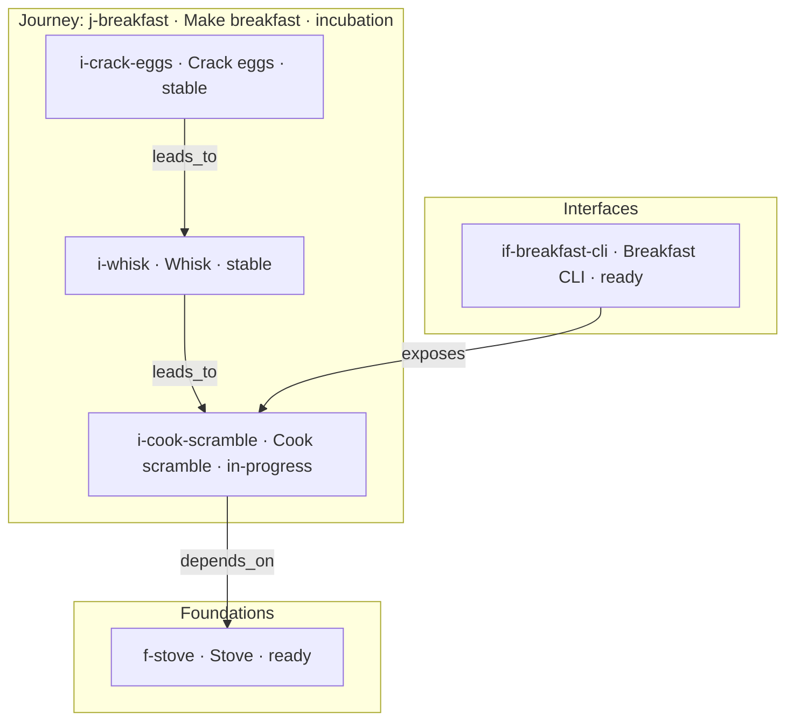

# MindPlan

**Everything works great until it doesn’t. MindPlan draws the boundaries your agent won’t.**

Without them you get a 5,000-line app file; MindPlan keeps your product’s structure in git and rejects any agent move that crosses it.

## In plain words

MindPlan names five kinds of thing. Type names stay for the graph and tools; plain words help humans and agents talk about them:

| Type | Plain word | Question | Example |
|------|------------|----------|---------|
| **Journey** | area | What does the product do? | Billing |
| **Interaction** | action | What can someone do? | Split the check |
| **Interface** | entry point | Where do they do it? | Checkout page, CLI, MCP tools |
| **Foundation** | building block | What does it all run on? | Database, design system, Stripe |
| **Bug** | bug | What's broken? | Double charge on split |

Links in plain words: `belongs_to` = is part of · `exposes` = shows · `depends_on` = needs · `leads_to` = then goes to · `affects` = breaks.

Rules in plain words: **Infrastructure First** — build the building blocks before the action that needs them. **Behavior First** — an action has to work before you put it on a page. **Completion Check** — finish the checklist before going live. **No Ghosts** — every action lives in an area and stands on a building block.

## Think in systems

Orient on the graph. Place each change on it. Respect the edges. Claim files. Classify shipped work by blast radius. That dialect plus this project's brief load through `get_project`. Before each action, call `get_rules` then `orient_for_work`. Before new-feature code, update or create nodes with the `plan-project` skill.

Without those boundaries, agents improvise from chat and tickets. The compiler refuses the illegal move:

```
Blocked: Infrastructure First. Interaction "i-checkout" cannot ship while
linked Foundations are not stable: "f-payments" (in-progress).
```

## Plans are made to be changed

The compiler refuses *illegal* moves; it does not freeze the plan.

- **Rewire** — `link_nodes` / `unlink_nodes` (`belongs_to`, `depends_on`, `exposes`, `leads_to`, `affects`, `mounts`)
- **Retreat** — `in-review` → `in-progress` when scope or checklist reality changes
- **Evolve** — shipped Foundations/Interactions/Interfaces keep the same id and a standing `<id>.next.mdx` twin (`state: mirror`); `open_next` flips it to `draft` → build → `ship` promotes over `<id>.mdx` and restores the twin
- **Revise together** — classify the blast radius. Sources get a full successor (`open_next`). Neighbors whose files changed but whose behavior did not are edited in place, with no `next` and no impact note. Nodes whose files did not change are left alone. Status then moves Foundations, then Interactions, then Interfaces, then Bugs, in one call, and stops on the first `Blocked:`
- **Ship after green check** — the implementer `ship`s when `run_check` (the CLI `mindplan-mcp check`) is green and legal transitions allow; moves to `in-review` and `ship` also run its import and ownership rules on the node's files, and `update_node_status` with `scope` walks every open update (or one change's revisions) through in-review to ship in one call — jumping past in-review needs `skip_review: true`, which is reported
- **Retire** — production work to `deprecated` when intent is replaced (Journeys stay; only Bugs truly close)

## See what the agent sees

After every graph mutation, MindPlan refreshes [`mindplan/map.md`](mindplan/map.md) — Journeys, Interactions, Interfaces, Foundations, and Bugs. On demand: MCP `export_mindplan_view` or CLI `mindplan-mcp view`.

Today's map is an **architecture + state** projection. A richer status board is planned.

## Worked example: scrambled eggs

An **area** (make breakfast), a **building block** (the stove), **actions** (crack, whisk, cook), and an **entry point** (the breakfast CLI):



- **Journey** `j-breakfast` — area: permanent capability (make breakfast)
- **Foundation** `f-stove` — building block; cook cannot ship until the stove is `stable`
- **Interactions** — actions (crack, whisk, cook); they share state via Foundations, never `depends_on` each other. `leads_to` is "then goes to" only (cycles allowed, not a ship gate)
- **Interface** `if-breakfast-cli` — entry point: how an actor starts cooking; ship needs exposed Interactions `stable` (**Behavior First**)

```
Blocked: Infrastructure First. Interaction "i-cook-scramble" cannot ship while
linked Foundations are not stable: "f-stove" (ready).
```

In plain words: you cannot go live with *cook scramble* while the *stove* building block is still only ready to build, not live.

## How it's built

Territory under `mindplan/` (Journeys, Foundations, Interactions, Interfaces, Bugs) plus optional `<id>.next.mdx` while a shipped node evolves. Nodes declare owned source files via `implements` / `set_implementation_files` (`mindplan/config.json` `sources`/`exclude` define the coverage universe). An MCP server is the single write path for server-owned frontmatter.

- **[SPEC.md](SPEC.md)** — graph, compiler rules, and tools
- **`src/`** — TypeScript MCP server (stdio)

## This repo's live plan

This repository dogfoods MindPlan. Live territory: [`mindplan/`](mindplan/). Map: [mindplan/map.md](mindplan/map.md).

## Who is this for

Built for people who ship **with AI agents** and need a living product architecture, not a stale ticket list. Best for indie developers and small teams where plan state is plain-text in git. Poor fit today for orgs that need multi-user permissions, audit trails, or sync with Jira/Linear.

## Quick start

**Not yet published to npm — install from source.**

1. Clone and build:

```bash
git clone https://github.com/nbiro/mindplan.git
cd mindplan
npm install && npm run build
```

2. From your project root, scaffold with the built server:

```bash
node /absolute/path/to/mindplan/dist/index.js init
```

`init` installs `mindplan/agent/` (playbook + skills), `mindplan/project.md` (a copy of `templates/agent/project.md` — description + rules, not the playbook) when missing, and a short MindPlan stub in `AGENTS.md` when missing. Host copies depend on `--host cursor|claude|all` (default `cursor`): Cursor gets `.cursorignore`, `.cursor/permissions.json`, `.cursor/rules/mindplan.mdc` and `.cursor/skills/`; Claude Code gets `CLAUDE.md` (an `@AGENTS.md` import) and `.claude/skills/`. It also renames legacy `current.mdx` / `next.mdx` territory files to `<id>.mdx` / `<id>.next.mdx`. The stub requires `get_project` before planning or code, `get_rules` then `orient_for_work` before each action, and the `plan-project` skill before new-feature graph work; when tools are hidden, use the init-installed host copies under `.cursor/` or `.claude/` and `AGENTS.md`.

3. Register the MCP server — see `mindplan/agent/integrations/` (or [templates/agent/integrations/README.md](templates/agent/integrations/README.md)).

4. Reload MCP servers after config changes.

## File system layout (consumer project)

```
<project-root>/
├── mindplan/
│   ├── config.json                # { sources, exclude } — coverage universe
│   ├── project.md                 # description + rules only (playbook via get_project)
│   ├── agent/                     # playbook + skills (installed by init)
│   ├── journeys/<id>/<id>.mdx
│   ├── foundations/<id>/<id>.mdx  # + optional <id>.next.mdx
│   ├── interactions/<id>/<id>.mdx # + optional <id>.next.mdx
│   ├── interfaces/<id>/<id>.mdx   # + optional <id>.next.mdx
│   └── bugs/<id>/<id>.mdx
└── …                              # app code wherever implements claims it
```

Owned files are declared with `set_implementation_files` (exact paths or directories ending in `/`) under the `sources`/`exclude` universe — there is no prescribed `src/<type>/<id>/` tree. This repo dogfoods that shape; consumers need not. Edge arrays in frontmatter: `belongs_to`, `depends_on`, `exposes`, `leads_to`, `affects`. See SPEC.md §1–§2.

## Taxonomy

| Type | What it is | States |
|------|------------|--------|
| **Journey** | Domain capability the architecture screams | Computed (`draft`, `incubation`, `stable`, `evolving`) |
| **Interaction** | Self-contained behavior (any actor) — **not** an entry surface; owns domain + mountable view/handler | Build pipeline + `stable`/`unstable` |
| **Interface** | How an actor enters an Interaction (Page, CLI, MCP, Webhook, Cron, …) — **mounts/wires only** | Build pipeline + `stable`/`unstable` |
| **Foundation** | Shared substrate by role (Assembler, Infra, Design system, Adapter) | Build pipeline + `stable`/`unstable` |
| **Bug** | Defect on Interaction, Interface, or Foundation | `open → triaged → fixing → in-review → resolved \| wontfix` |

Journeys scream the domain · Interactions are behaviors (they own the screen body / handler) · Interfaces are entry (they only mount) · Foundations are shared substrate · Assembler composes them.

**Build pipeline** (Foundation/Interaction/Interface): `draft → ready → in-progress → in-review → ship` → computed `stable`/`unstable`.

## Compiler Rules

Every violation starts with `Blocked: `.

1. **No Ghost Interactions** — need `belongs_to` + Foundation `depends_on` before `ready`/`in-progress`
2. **No Ghost Interfaces** — need `exposes` before `ready`/`in-progress`
3. **No Ghost Bugs** — need `affects` before `triaged`/`fixing`
4. **Infrastructure First** — Interaction `ship` needs all Foundation deps `stable`
5. **Behavior First** — Interface `ship` needs all exposed Interactions (and Foundation deps) `stable`
6. **Completion Check** — unchecked `[ ]` block `ship` (and Bug `resolved`)
7. **Interaction Independence** — no Interaction → Interaction `depends_on` (share state via Foundations)
8. **Computed Journeys / Stability** — never set manually
9. **Taxonomy** — legal edge shapes; `depends_on` acyclic; `leads_to` cycles allowed
10. **Next Evolution / Force Unship** — stable-id `open_next`; recovery only with explicit `confirm`

No Dependency Closure / `link_dependent`.

## MCP Tools

The descriptions the MCP server sends to clients — each tool's `description` and each argument's `.describe()` — are registered in [`src/interfaces/if-mcp-tools/register.ts`](src/interfaces/if-mcp-tools/register.ts). Inputs, outputs, effects, and errors are specified in [SPEC.md §8](SPEC.md#8-mcp-tool-contract).

| Tool | Kind | Description |
|------|------|-------------|
| `orient_for_work` | read | find + `record`/`body` context + blast radius (grouped files; retired omitted; Interaction focus includes `reachability`); `depth: rules\|body\|full` trims it |
| `run_check` | read | The same integrity check as `mindplan-mcp check` (`ok`, `output`, `failures`, `warnings`); unclaimed files and illegal imports come with their fix; `change` also gates every revision in a change |
| `find_related_nodes` | read | Rank by query; focus + 1-hop |
| `get_mindplan_graph` | read | Assembled nodes/edges (`version: 1`) |
| `export_mindplan_view` | read | Mermaid or DOT |
| `get_blast_radius` | read | Reverse-`depends_on` affected + grouped `affected_files` for a node or a whole `change`; cancelled/deprecated omitted unless `include_retired` |
| `get_node_context` | read | `record` + `body` (+ `next.record`/`next.body` when evolving) |
| `get_node_implementation` | read | Owned files for a node, or path → owner lookup |
| `set_implementation_files` | mutation | Set `implements` claims (files or directories ending in `/`) |
| `patch_node_territory` | mutation | Required writer for territory prose (title/description/body/checkboxes) |
| `patch_node_rules` | mutation | Write one node's `## Rules`; `orient_for_work` delivers them to the node and everything that inherits from it |
| `patch_project_description` | mutation | Write the `mindplan/project.md` description |
| `patch_project_rules` | mutation | Write the `mindplan/project.md` rules |
| `patch_config` | mutation | Write `mindplan/config.json` sources/exclude |
| `put_attachment` / `remove_attachment` | mutation | Node attachment files |
| `create_node` | mutation | Journey, Foundation, Interaction, Interface, or Bug (territory only; no src scaffold) |
| `open_next` / `discard_next` | mutation | Flip mirror→draft / restore mirror twin |
| `link_nodes` / `unlink_nodes` | mutation | Five edge types; no `link_dependent` |
| `update_node_status` | mutation | One node, or a `revisions` list ordered Foundation → Interaction → Interface → Bug; stops on the first `Blocked:` |
| `force_unship` | mutation | Mistaken-ship recovery (`confirm: "unship:<id>"`) |

## CLI

| Command | Description |
|---------|-------------|
| `mindplan-mcp` | Start MCP server (stdio) |
| `mindplan-mcp init` | Scaffold territory + agent assets |
| `mindplan-mcp view` | Print Mermaid/DOT (`export` alias) |
| `mindplan-mcp check` | Offline integrity (graph + file ownership + import matrix); `--base` opt-in dirty-src; also the `run_check` MCP tool |
| `mindplan-mcp help` | Usage |

Set `MINDPLAN_ROOT` to override the project root (default `process.cwd()`).

## Development

See [CONTRIBUTING.md](CONTRIBUTING.md).

```bash
npm install
npm run build
npm test
```

## License

[MIT](LICENSE)
