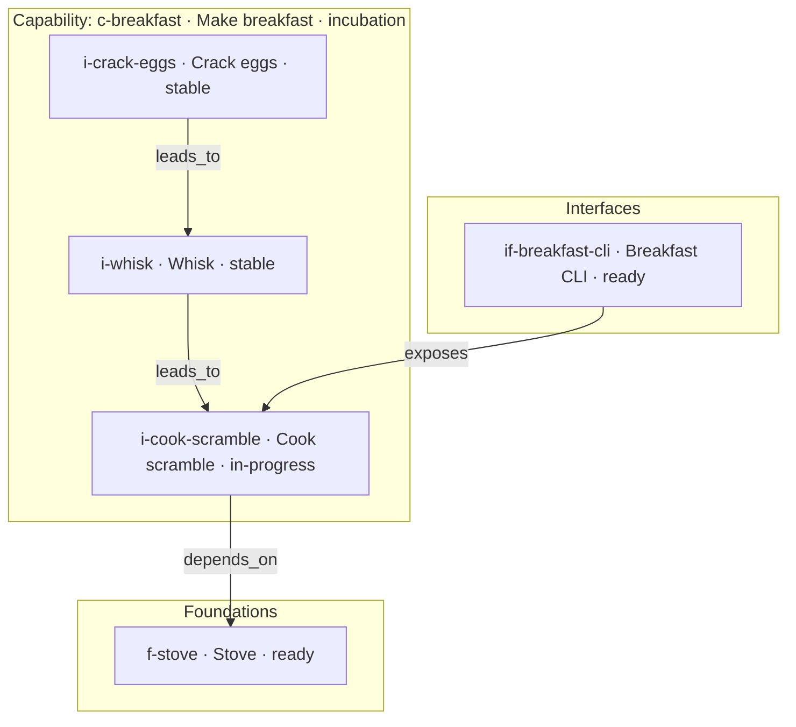

# MindPlan

**Everything works great until it doesn’t. MindPlan draws the boundaries your agent won’t.**

Without them you get a 5,000-line app file; MindPlan keeps your product’s structure in git and rejects any agent move that crosses it.

## Five kinds of node

MindPlan names five kinds of thing. The type names are the vocabulary, in the graph, in the tools, and in conversation:

| Type | Question | Example | Closest established term |
|------|----------|---------|--------------------------|
| **Capability** | What does the product do? | Billing | Business capability, bounded context |
| **Interaction** | What can someone do? | Split the check | Use case |
| **Interface** | Where do they do it? | Checkout page, CLI, MCP tools | Driving adapter, C4 container |
| **Foundation** | What does it all run on? | Database, design system, Stripe | Driven adapter, infrastructure, shared kernel |
| **Bug** | What's broken? | Double charge on split | Defect |

The last column maps each type onto a term you already know. It is not a synonym: SPEC §2.0.0 says where each type differs from it. Use the type names.

**Edges:** `belongs_to` (is part of) · `exposes` (shows) · `depends_on` (needs) · `leads_to` (then goes to) · `affects` (breaks) · `mounts` (a Foundation that wires Interfaces together may import them). Legal shapes: SPEC §2.2.

An Interaction owns its behavior, screen body or handler included; an Interface only mounts it. Foundations come in four roles: Assembler, Infra, Design system, Adapter (SPEC §2.0.1).

## Think in systems

A new behavior is a new node, and the graph describes the code before it merges. `get_project` loads that dialect plus this project's brief; when the agent plans is its call, and the server holds the line: writes wait until the project rules and the node's rules reached the session, every source file needs an owner, and the merge gate blocks a node whose code changed but whose graph entry did not.

Without those boundaries, agents improvise from chat and tickets. The compiler refuses the illegal move:

```
Blocked: Infrastructure First. Interaction "i-checkout" cannot ship while linked Foundations
are not stable: "f-payments" (in-progress). A dependency counts once stable, or in-review with
at least one checklist item, every build item ticked, and its own dependencies counting the same way.
```

## Rules

Every violation is a tool error that starts with `Blocked:` and names the fix. SPEC §5 states each rule in full.

| Rule | What it blocks | SPEC |
|------|----------------|------|
| No Ghost Interactions | `ready` / `in-progress` until the Interaction `belongs_to` a Capability and `depends_on` a Foundation | §5.2 |
| No Ghost Interfaces | `ready` / `in-progress` until the Interface `exposes` an Interaction | §5.3 |
| No Ghost Bugs | `triaged` / `fixing` until the Bug `affects` an Interaction, Interface, or Foundation | §5.7 |
| Infrastructure First | An Interaction's `ship` until every Foundation it `depends_on` is ready for dependents: `stable`, or `in-review` with at least one checklist item, every `build` item ticked, and its own dependencies ready | §5.4 |
| Behavior First | An Interface's `ship` until every Interaction it `exposes` and every Foundation it `depends_on` is ready for dependents (same test) | §5.5 |
| Completion Check | `ship` (a Bug: `resolved`) while any checklist item is unticked. The default `spec` and `impl` items close at ship, and `verify` once `run_check({ run_tests: true })` passes the node's linked tests | §5.6, §3.3 |
| Computed Capabilities / Computed Stability | Setting a Capability's state, or `stable` / `unstable`, by hand: the server computes them | §5.8, §5.9 |
| Taxonomy enforcement and Interaction Independence | Illegal edge shapes, self-links, duplicates, `depends_on` cycles (`leads_to` may cycle), and any Interaction → Interaction `depends_on` (share state through a Foundation) | §5.10 |
| Version Lineage | `open_next` on anything but a shipped Foundation, Interaction, or Interface, without a change id, or for a change already open on that node | §5.11 |
| Force Unship | Undoing a ship without `confirm: "unship:<id>"` | §5.12 |
| Decision gate | `in-review` for work on a shipped Foundation, work that adds a schema file, work with a wide blast radius, or a change to a shipped node's `depends_on`, until a decision is recorded | §5.13 |
| Coverage and import matrix | A source file no node claims, a file two nodes claim, an import the edges do not allow. The check reports them; moves to `in-review` and `ship` run the import and ownership rules on the node's files | §1.2, §9.6 |
| Orientation gate | A write on a node not oriented on in this session, or whose rules changed since (`open_next`, `patch_node_territory`, and `set_implementation_files` orient a new node themselves) | §8.1.2 |
| Rule checks | A project or node rule's `check:` line that fails: a forbidden path or pattern, a missing required pattern, or a command's exit code | §6.1.4 |
| Version gate | Graph tools while `mindplan/` needs setup or an upgrade, or is newer than the server (`Blocked: Version`) | §1.1.2 |

**Lifecycle** (SPEC §3–§4):

- Foundation, Interaction, Interface: `draft → ready → in-progress → in-review → ship`, then computed `stable` / `unstable` (an open Bug makes it `unstable`). `cancelled` abandons unshipped work; `deprecated` retires shipped work.
- Bug: `open → triaged → fixing → in-review → resolved | wontfix`.
- Capability: computed from its Interactions: `draft`, `incubation`, `stable`, `evolving`.

`in-review` is a checkpoint, not a review process: code review stays with your host or your project rules.

## Plans are made to be changed

The compiler refuses illegal moves; it does not freeze the plan.

- **Rewire** — `link_nodes` / `unlink_nodes`.
- **Retreat** — `in-review` → `in-progress` when scope or the checklist changes.
- **Evolve** — a shipped Foundation, Interaction, or Interface keeps its id. `open_next({ node_id, change, reason })` opens a revision, `revisions/<change>/<id>.mdx`, and records why (`behavior`, `wiring`, `fix`, `platform`, `text`, or `refactor`); shipping it writes it over `<id>.mdx`. A node holds at most one open revision per change; shipping one rebases the others, and a section both changed becomes a conflict for `resolve_conflict` (SPEC §3.6).
- **Revise together** — classify the blast radius: sources get a revision, neighbors whose files change but whose behavior does not are edited in place, the rest are left alone. One change id groups the work, and one `update_node_status({ scope: "change", … })` call walks it, Foundations first (SPEC §3.7).
- **Ship after a green check** — the implementer ships when `run_check` passes and the rules allow (SPEC §9.6).
- **Decide on the record** — `record_decision` keeps the choice, the rejected alternative, and the reason on the node; the next agent gets it from `orient_for_work` (SPEC §5.13).
- **Work in parallel** — one server serves every git worktree: each agent passes `root` to every tool. After a merge, `run_check({ after_merge: true })` names what to fix, and `rebase_revision` carries a revision onto the live text the other branch shipped (SPEC §9.4).
- **Retire** — `deprecated` for shipped work whose intent is replaced, `cancelled` for unshipped work. Capabilities stay; only Bugs close.

## Worked example: scrambled eggs

A **Capability** (make breakfast), a **Foundation** (the stove), **Interactions** (crack, whisk, cook), and an **Interface** (the breakfast CLI):



- **Capability** `c-breakfast` — what the product does; a permanent container.
- **Foundation** `f-stove` — only `ready`, so shipping *cook scramble* is `Blocked: Infrastructure First` until the stove is `stable`, or in review with its build items ticked.
- **Interactions** — crack, whisk, cook. They share state through Foundations, never `depends_on` each other. `leads_to` only means "then goes to": cycles are allowed and it gates nothing.
- **Interface** `if-breakfast-cli` — how an actor starts cooking. It ships only once the Interactions it exposes are ready (Behavior First).

## See the map

After every graph write the server refreshes `mindplan/map.md`, a Mermaid view of every node and its state. It is derived, so `mindplan/.gitignore` ignores it and no tool lists it in `changed_files`. On demand: `export_mindplan_view` or `mindplan-mcp view`. This repository plans itself with MindPlan: see [`mindplan/`](mindplan/).

## Who is this for

People who ship **with AI agents** and need a living product architecture, not a stale ticket list. Best for indie developers and small teams where plan state is plain text in git. A poor fit today for organizations that need multi-user permissions, audit trails, or sync with Jira or Linear.

## Requirements

Node.js 22.13 or later (`engines` in `package.json`; the search cache uses `node:sqlite`). No clone or build step: the package ships `dist/` and the agent templates.

## Quick start

1. **Install.** In a project with a `package.json`, add a dev dependency so the lockfile pins the version for everyone, CI, and containers:

   ```bash
   npm install -D mindplan-mcp
   ```

   Any other project (Python, Go, …) installs nothing and uses `npx -y mindplan-mcp@0.23` in the config below.

2. **Register the MCP server.** It runs over stdio from the project root. In Claude Code, run `claude mcp add mindplan -- npx mindplan-mcp`, or commit a `.mcp.json` so everyone who opens the repo gets it (Cursor reads the same shape from `.cursor/mcp.json`; the package ships it as `templates/agent/mcp.json.example`):

   ```json
   {
     "mcpServers": {
       "mindplan": { "type": "stdio", "command": "npx", "args": ["mindplan-mcp"] }
     }
   }
   ```

   With a dev dependency, `npx mindplan-mcp` runs the locked copy (run `npm install` first in a fresh container). Without one, use `"args": ["-y", "mindplan-mcp@0.23"]`. Other hosts: [templates/agent/integrations/](templates/agent/integrations/README.md). Reload MCP servers after a config change.

3. **Ask your agent to set up MindPlan.** It calls `setup_project`, which creates `mindplan/` (a default `config.json`, an empty `project.md`, and the `version.json` stamp) and returns `pointer`, the short text every session must see first, plus a guide. Following the guide, the agent writes `MINDPLAN.md` and wires it into the files your agent reads, adds the ignores, proposes moving your standing rules into the project brief, asks for a product description, and offers the [merge gate](#the-check-and-the-merge-gate). The server never writes those files itself; the agent shows you each change. The skills (`plan-project`, `define-entities`) are served through `get_skill`, so nothing is copied into `.claude/` or `.cursor/`.

### Upgrading

Bump the package (`npm update mindplan-mcp`, Dependabot, or a new `npx` range) and reload the MCP server: a running server keeps the code it started with, and until it restarts `get_project` returns a `restart` field naming both versions. A release that adds a graph migration raises the server's migration level. Until `mindplan/version.json` reaches it, every graph tool answers `Blocked: Version`, `get_project` returns a `version` field naming the fix, and `mindplan-mcp check` fails. Ask your agent to upgrade MindPlan: it calls `upgrade_project`, which runs every migration (each is idempotent), stamps the new level, and returns a guide. The agent then deletes the host copies it reports as `leftovers`, refreshes `MINDPLAN.md` when `pointer_outdated`, and commits the upgrade on its own. A stamp newer than your server (a teammate upgraded first) blocks too, until you upgrade `mindplan-mcp`. While on 0.x, read [CHANGELOG.md](CHANGELOG.md) before crossing a minor version. Details: SPEC §1.1.2.

### From source (contributors)

```bash
git clone https://github.com/nbiro/mindplan.git
cd mindplan
npm install && npm run build
```

Then register `node /absolute/path/to/mindplan/dist/index.js` (with `MINDPLAN_ROOT` set to your project root) as the MCP server command instead of `npx mindplan-mcp`.

## File layout (consumer project)

```
<project-root>/
├── .mindplan-cache/               # derived graph and search caches (gitignored, safe to delete)
├── mindplan/
│   ├── config.json                # see Configuration
│   ├── project.md                 # the brief: description + rules (the playbook comes from get_project)
│   ├── version.json               # { package, graph, migrations }: drives the version gate
│   ├── .gitignore                 # ignores map.md
│   ├── map.md                     # derived Mermaid snapshot
│   ├── capabilities/<id>/<id>.mdx # + decisions/<decision-id>.md, one file per decision
│   ├── foundations/<id>/<id>.mdx  # + decisions/, + revisions/<change>/<id>.mdx per open revision
│   ├── interactions/<id>/<id>.mdx # + decisions/, + revisions/<change>/<id>.mdx per open revision, + confirmed.json
│   ├── interfaces/<id>/<id>.mdx   # + decisions/, + revisions/<change>/<id>.mdx per open revision
│   └── bugs/<id>/<id>.mdx
└── …                              # your code, wherever nodes claim it
```

The MCP server is the only writer of `mindplan/`. Nodes claim their source files with `set_implementation_files` (exact paths, or directories ending in `/`); there is no prescribed `src/<type>/<id>/` tree. Edges live in the source node's frontmatter: `belongs_to`, `depends_on`, `exposes`, `leads_to`, `affects`, `mounts`. See SPEC §1, §6, §7.

## The check and the merge gate

| Command | What it does |
|---------|--------------|
| `mindplan-mcp` | Start the MCP server (stdio) |
| `mindplan-mcp view` (alias `export`) | Print the map as Mermaid or DOT (`--format`, `--focus <id>`, `--output <file>`) |
| `mindplan-mcp check` | Offline integrity check: graph, file ownership and coverage, import matrix. Fails with `Blocked: Version` while the graph needs setup or an upgrade. The `run_check` tool returns the same output |
| `check --base <ref>` | Also checks changed files against their owners' states (dirty-src) |
| `check --merge`, `check --merge=strict` | The merge gate (below) |
| `check --after-merge` | Names what merging two branches that both changed the graph left behind |
| `check --root <path>` | Checks another checkout |
| `mindplan-mcp hook pre-tool-use` | The Claude Code hook: denies host file writes on `mindplan/**` (below) |
| `mindplan-mcp help` | Usage |

**Merge gate.** The default branch should hold work that is done (`stable` / `unstable`) or still being built, never work that is `in-review`: the code is finished but the graph has not shipped it, and that belongs on a branch. Plain `check` ignores lifecycle state; `check --merge` fails with one `Blocked: Merge` line per Foundation, Interaction, or Interface whose live file or open revision is `in-review`, and per Bug in `in-review`, grouped by change id. Each line names the fix: `update_node_status({ scope: "change", change: "<id>", new_status: "ship" })`, or move the node back to `in-progress` (a Bug: `fixing`) if the work is unfinished. `draft`, `ready`, `in-progress`, and shipped nodes pass, so planning PRs and incremental PRs still merge. It also fails a shipped node whose claimed files changed against the base while its territory file did not: the graph must describe the code before it merges, so the fix is `open_next` and ship, `patch_node_territory` in place, or, when the node's text still holds, `confirm_territory({ node_id, note })`, which pins the changed files' content in the node's `confirmed.json` (editing them again blocks again). Agents run the same gate as `run_check({ merge: true })` before saying a PR is ready.

`--merge=strict` also fails an `in-progress` node whose claimed files changed against the base: a finished feature left at `in-progress`. The base is `--base <ref>`, else the merge base with the newer of `main` and `origin/main` (else `master`). It is opt-in because it blocks the incremental PRs of a large feature. An explicit `--base` also turns on the dirty-src check.

**In CI.** Ask your agent to install the GitHub Actions workflow; it calls `setup_project({ ci: "github" })`, which writes `.github/workflows/mindplan-merge-gate.yml` at the repository top (a project in a subfolder gets it there too, running in its folder). It runs `check --merge` on every pull request to the default branch; an existing workflow file is kept as it is. Then make its **mindplan merge gate** job a required status check for the default branch (Settings → Branches, or a ruleset), or a red gate does not stop the merge.

**Rule checks.** A project or node rule can carry indented `check:` lines that the check runs: `{"forbid_path": glob}`, `{"forbid_pattern": regex, "in": glob}`, `{"require_pattern": regex, "in": glob}`, or `{"command": cmd, "expect_exit": 0}`. A failure is `Blocked: Rule: …` with the offending lines. Command checks run only when `rule_checks.commands` allows. SPEC §6.1.4.

```markdown
- Site content only through the SnapSite MCP.
  check: {"forbid_pattern": "payload\\.(update|create)\\(\\{\\s*collection: \"pages\"", "in": "src/payload/scripts/**"}
```

**Linked tests.** With `tests.command` set (for example `npm run test:files -- {files}`), `run_check({ run_tests: true, change })` runs the linked tests of the change's nodes; a failure is `Blocked: Tests`, and a pass closes each node's `verify` item for this server session.

**Keep host writes out of `mindplan/`.** Agents may read the graph's files directly; every write goes through the MindPlan tools. In Claude Code, ask your agent to call `setup_project({ install_hook: true })` (or `upgrade_project`): it adds a PreToolUse hook to `.claude/settings.json` that denies `Edit`, `MultiEdit`, `Write`, and `NotebookEdit` on `mindplan/**` and names the MindPlan tool to use instead (SPEC §9.8).

Full modes and output: SPEC §9.6.

## Configuration

`mindplan/config.json` is edited with `patch_config`. It must hold `sources` and `exclude` (`setup_project` writes the defaults below; with no config file at all, the server uses them). Every other block is optional, and an absent setting takes its default. An unknown key or a bad value inside a block is `Blocked:`; other top-level keys are ignored (SPEC §1.2.1).

| Key | Default | Sets |
|-----|---------|------|
| `sources` | `["src/**"]` | Globs of the files nodes must claim (the coverage universe) |
| `exclude` | `[]` | Globs taken out of `sources` |
| `decisions.blast_radius` | `5` | Dependents above which a revision needs a decision |
| `decisions.schema_files` | database migrations and schema dumps (`**/migrations/**`, `**/*.prisma`, `**/schema.sql`, …) | Files that make a revision need a decision when it adds one |
| `hotspots.half_life_days`, `hotspots.outlier_ratio`, `hotspots.min_rate` | `30`, `3`, `2` | The `hotspot:` warning: how fast a ship rate fades, how far above the median counts, and the lowest rate that can count |
| `fan_out.warn_at` | `3` | How many other unshipped changes a pre-ship node's `depends_on` may reach before `fan-out:` warns |
| `fan_in.exempt_roles` | `["assembler", "design-system"]` | Foundation roles that never get the `fan-in:` warning (a pre-ship Foundation with more direct dependents than `decisions.blast_radius`) |
| `search.enabled` | `true` | `false` turns semantic ranking off (keyword ranking always runs) |
| `search.model` | `Xenova/bge-small-en-v1.5` | The transformers.js embedding model (changing it rebuilds the search cache) |
| `replies.budget_bytes` | `8192` | Cap on one tool reply's JSON; longer lists come back cut, with a `next_page` cursor (`0` turns it off). Rule text and `Blocked:` lines are never cut |
| `replies.legacy` | `false` | `true` restores the 0.22 reply shapes: the full drift report and rule text on every reply |
| `tests.command` | none | How `run_check({ run_tests: true })` runs linked tests; must contain `{files}`, e.g. `npm run test:files -- {files}` |
| `rule_checks.commands` | `"off"` | When rules' `command` checks run: `"off"`, `"local"` (not when `CI` is set), or `"always"` |

| Environment variable | Effect |
|----------------------|--------|
| `MINDPLAN_ROOT` | Project root (default: the working directory) |
| `MINDPLAN_SEARCH=keyword` | Keyword-only search for this process |
| `MINDPLAN_SEARCH_OFFLINE=1` | Use only an already-downloaded model |
| `MINDPLAN_MODEL_CACHE` | Model download folder (default `~/.cache/mindplan/models`) |
| `MINDPLAN_GRAPH_CACHE` | `off` turns the graph cache off for this process (`git` or `stamps` forces one freshness mode) |
| `MINDPLAN_GRAPH_MEMO` | `off` makes every graph load within one tool call check the files again (`verify` also compares each reuse with a full load; CI uses it) |
| `MINDPLAN_VERSION_GATE=off` | For tests: turns the version gate off (fixtures without a stamp) |
| `MINDPLAN_ORIENT_GATE=off` | For tests: turns the orientation gate off |

## Search

`find_related_nodes` and `orient_for_work` rank nodes with hybrid search: keyword (SQLite FTS5, or the same BM25 in plain JS where FTS5 is missing, as on Node 22.13) and semantic (a small local embedding model), fused by rank, plus a small boost for nodes linked to the best matches. An exact id ranks first, and a file path ranks the node that claims it. A query saying "quote" can find a node that says "enquiry".

The index, `.mindplan-cache/index.db`, is derived from the `.mdx` files, gitignored, re-synced on every search (a `git pull` or branch switch shows up on the next call), and safe to delete. The model (`Xenova/bge-small-en-v1.5`, about 30 MB) runs locally through the optional dependency [transformers.js](https://huggingface.co/docs/transformers.js): no API key, nothing leaves the machine. It downloads once per machine in the background; a tool call never waits for it. Until it is ready, or when it cannot load (offline, a proxy, a sandbox, `npm install --omit=optional`), search is keyword-only and never fails, and the reason is logged once to stderr. SPEC §8.1.1. The model's native modules load from a copy in `~/.cache/mindplan/runtime/` (about 100 MB, made once per version), never from your project's `node_modules`, so `npm ci` and `npm install` work on Windows while the server runs.

## Graph cache

Every tool call loads the graph, so the server keeps parsed node records in memory and in `.mindplan-cache/graph.db`, and re-parses only node folders that changed. A load always returns what parsing every file would. Within one tool call, later loads reuse the first one except for the folders the call wrote. The cache is derived from the `.mdx` files, gitignored, and safe to delete; `MINDPLAN_GRAPH_CACHE=off` turns it off for one process. SPEC §1.1.3.

## MCP tools

The server has 42 tools; [SPEC §8](SPEC.md#8-mcp-tool-contract) specifies each one's inputs, outputs, and errors. Every tool takes an optional `root`, the checkout or git worktree whose `mindplan/` that call uses. Every tool except `get_project`, `get_rules`, `get_spec`, `get_skill`, `run_check`, `acknowledge_warning`, `doctor`, `setup_project`, and `upgrade_project` is behind the version gate. Results are compact JSON plus `structuredContent`, kept under `replies.budget_bytes` (longer lists are paged with `next_page`). Replies leave out what the session already received: rule text comes back as `unchanged` (`resend_rules: true` sends it again), and `drift` is a count plus the paths not shown yet (`get_drift` lists them all). MCP annotations mark read tools `readOnlyHint` and the four destructive ones `destructiveHint`, so a host can auto-approve reads and prompt on the rest. Tool and argument descriptions live in each Interaction's `tools.ts` under [`src/interactions/`](src/interactions/), mounted by [`src/interfaces/if-mcp-tools/register.ts`](src/interfaces/if-mcp-tools/register.ts).

**Orient and read**

- `get_project` — the dialect (playbook) plus this project's description and rules; call it first.
- `get_rules` — re-read the mandatory project rules (after a context summary); writes are `Blocked: Rules` until they reached the session.
- `orient_for_work` — ranked nodes for a query, or one node's rules (own and distance-1 in full, further sources as one line), decisions, body, and files, with a blast radius summary at `depth: "full"`; unlocks writes on that node. `node_ids` orients on several nodes in one call, `change` on a whole change.
- `find_related_nodes` — hybrid search plus the 1-hop neighborhood.
- `list_areas` — every Capability with counts of its nodes.
- `get_node_context` — one node's record, body, and decisions (live or a revision); `section` or `slot` returns just that part.
- `find_in_node` — a node's exact text: matching lines with a unique snippet ready for `patch_node_territory`'s `replace`.
- `search_graph` — which nodes' text mentions a path, a term, or a phrase.
- `get_node_implementation` — a node's owned files, or the owner of a path.
- `get_blast_radius` — what depends on a node or a change: a summary (counts, top dependents, tests to run) by default, every row and file with `detail: "full"`.
- `get_drift` — every uncommitted source file whose owner is not being changed, or that no node claims.
- `next_page` — the rest of a list a long reply cut.
- `get_mindplan_graph` — the graph, paged and filterable.
- `export_mindplan_view` — the map as Mermaid or DOT.
- `list_decisions` — decision records of a node, a change, or the graph.
- `get_spec` — one section of the running server's SPEC.
- `get_skill` — the served skills (`plan-project`, `define-entities`).

**Write the graph**

- `create_node` — a new Capability, Interaction, Interface, Foundation, or Bug.
- `link_nodes` / `unlink_nodes` (`unlink_nodes` is destructive) — add or remove an edge, or plan one under a change.
- `patch_node_territory` — a node's title, description, body, checklist, and search aliases. `reason: "text"` fixes wording on a shipped node in place, in one call.
- `patch_node_rules` — a node's `## Rules`.
- `set_implementation_files` — the source files a node claims.
- `set_test_files` — the tests that verify a node.
- `record_decision` — a decision record on the node it shapes.
- `put_attachment` / `remove_attachment` (`remove_attachment` is destructive) — node attachment files.
- `open_next` / `discard_next` (`discard_next` is destructive) — open a revision of a shipped node with its reason, or delete one.
- `resolve_conflict` — settle a conflict a sibling revision's ship left.
- `rebase_revision` — carry a revision onto current live after a merge.
- `confirm_territory` — record that a shipped node's text still describes its changed files, for the merge gate.
- `patch_project_description` / `patch_project_rules` — the project brief.
- `patch_config` — `mindplan/config.json`.

**Change status**

- `update_node_status` — move one node, a batch, or a whole change along its lifecycle.
- `force_unship` (destructive) — undo a mistaken ship, with explicit confirmation.

**Check**

- `run_check` — the integrity check, compact by default; also the merge and after-merge gates, and with `run_tests` the nodes' linked tests.
- `acknowledge_warning` — accept known check warnings so compact checks stop listing them.

**Set up and maintain**

- `setup_project` — create `mindplan/`; returns the pointer and the setup guide (and writes the CI workflow or the Claude Code hook on request).
- `upgrade_project` — run the graph migrations and stamp the new level; returns the upgrade guide (and installs the Claude Code hook on request).
- `doctor` — server health in any graph state.

## Docs and development

- [SPEC.md](SPEC.md) — the normative specification: graph, rules, and tools.
- [CHANGELOG.md](CHANGELOG.md) — release history and breaking changes.
- [CONTRIBUTING.md](CONTRIBUTING.md) — how to contribute.

```bash
npm install
npm run build
npm test
```

## License

[MIT](LICENSE)
