# MindPlan map

_Auto-generated after each graph mutation (45 nodes, 117 edges). Do not edit by hand._

_How to read this:_ Journey = area · Interaction = action · Interface = entry point · Foundation = building block · Bug = bug.

```mermaid
flowchart TB
  subgraph foundations["Foundations"]
    f_compiler_rules["f-compiler-rules · Compiler rules · stable"]
    f_console_client["f-console-client · Console client · ready"]
    f_console_shell["f-console-shell · Console shell · ready"]
    f_design_system["f-design-system · Console design system · ready"]
    f_domain_model["f-domain-model · Domain model · stable"]
    f_framework_docs["f-framework-docs · Framework docs · stable"]
    f_github_actions["f-github-actions · GitHub Actions · stable"]
    f_graph_cache["f-graph-cache · Graph cache · unstable"]
    f_graph_search["f-graph-search · Graph search · stable"]
    f_mcp_runtime["f-mcp-runtime · MCP runtime · stable"]
    f_nextjs["f-nextjs · Next.js assembler · ready"]
    f_npm_registry["f-npm-registry · npm registry adapter · stable"]
    f_orientation_ledger["f-orientation-ledger · Orientation ledger · stable"]
    f_search_index["f-search-index · Search index · stable"]
    f_source_index["f-source-index · Source index · unstable"]
    f_territory_store["f-territory-store · Territory store · unstable"]
    f_test_harness["f-test-harness · Test harness · stable"]
    f_view_projection["f-view-projection · View projection · stable"]
    f_xyflow["f-xyflow · XYFlow adapter · ready"]
  end
  subgraph interfaces["Interfaces"]
    if_cli{{"if-cli · CLI · stable"}}
    if_console{{"if-console · Console · ready"}}
    if_console_api{{"if-console-api · Console API · ready"}}
    if_mcp_tools{{"if-mcp-tools · MCP tools · unstable"}}
    if_publish_script{{"if-publish-script · Publish script · ready"}}
    if_release_tag{{"if-release-tag · Main-branch release trigger · draft"}}
  end
  subgraph journey_j_agent_onboarding["j-agent-onboarding · Adopt MindPlan · evolving"]
    i_init_project__in__j_agent_onboarding["i-init-project · Init project · stable"]
    i_npm_publish__in__j_agent_onboarding["i-npm-publish · Publish to npm · stable"]
  end
  subgraph journey_j_npm_publish["j-npm-publish · Ship to npm · evolving"]
    i_npm_publish__in__j_npm_publish["i-npm-publish · Publish to npm · stable"]
    i_npm_tag_publish__in__j_npm_publish["i-npm-tag-publish · Publish on merge to main · stable"]
  end
  subgraph journey_j_plan_console["j-plan-console · See and steer the plan · stable"]
    i_browse_territory__in__j_plan_console["i-browse-territory · Read territory · ready"]
    i_explore_graph__in__j_plan_console["i-explore-graph · Explore the graph · ready"]
    i_model_plan__in__j_plan_console["i-model-plan · Model the plan · ready"]
    i_steer_plan__in__j_plan_console["i-steer-plan · Steer the plan · unstable"]
    i_view_status__in__j_plan_console["i-view-status · Status board · ready"]
  end
  subgraph journey_j_territory_sdlc["j-territory-sdlc · Plan software · evolving"]
    i_check_integrity__in__j_territory_sdlc["i-check-integrity · Check integrity · unstable"]
    i_export_map__in__j_territory_sdlc["i-export-map · See the map · stable"]
    i_orient_plan__in__j_territory_sdlc["i-orient-plan · Orient on the plan · stable"]
    i_steer_plan__in__j_territory_sdlc["i-steer-plan · Steer the plan · unstable"]
  end
  bug_body_leading_blank_lines["bug-body-leading-blank-lines · Bodies start with runs of blank lines · in-review"]
  bug_default_base_stale_local_main["bug-default-base-stale-local-main · The default base uses a stale local main · in-review"]
  bug_dirty_src_repo_relative_paths["bug-dirty-src-repo-relative-paths · Dirty-src paths are repo-relative when the project is in a subfolder · in-review"]
  bug_note_toggle_needs_checked["bug-note-toggle-needs-checked · A note toggle without checked is Blocked · in-review"]
  bug_windows_transient_file_lock["bug-windows-transient-file-lock · A write fails when Windows briefly locks a new node file · in-review"]
  bug_body_leading_blank_lines -.-> f_territory_store
  bug_default_base_stale_local_main -.-> f_source_index
  bug_dirty_src_repo_relative_paths -.-> i_check_integrity__in__j_territory_sdlc
  bug_note_toggle_needs_checked -.-> f_territory_store
  bug_note_toggle_needs_checked -.-> if_mcp_tools
  bug_windows_transient_file_lock -.-> f_graph_cache
  bug_windows_transient_file_lock -.-> f_territory_store
  bug_windows_transient_file_lock -.-> i_steer_plan__in__j_plan_console
  f_compiler_rules --> f_domain_model
  f_compiler_rules --> f_source_index
  f_compiler_rules --> f_territory_store
  f_console_shell --> f_console_client
  f_console_shell --> f_design_system
  f_console_shell --> f_nextjs
  f_framework_docs --> f_domain_model
  f_github_actions --> f_npm_registry
  f_graph_cache --> f_domain_model
  f_graph_cache --> f_source_index
  f_graph_search --> f_domain_model
  f_graph_search --> f_search_index
  f_mcp_runtime --> f_framework_docs
  f_mcp_runtime --> f_graph_search
  f_mcp_runtime --> f_orientation_ledger
  f_mcp_runtime --> f_territory_store
  f_orientation_ledger --> f_domain_model
  f_orientation_ledger --> f_graph_search
  f_search_index --> f_source_index
  f_source_index --> f_domain_model
  f_territory_store --> f_domain_model
  f_territory_store --> f_graph_cache
  f_territory_store --> f_source_index
  f_test_harness --> f_mcp_runtime
  f_view_projection --> f_domain_model
  f_view_projection --> f_graph_search
  f_view_projection --> f_territory_store
  f_xyflow --> f_design_system
  i_browse_territory__in__j_plan_console --> f_console_client
  i_browse_territory__in__j_plan_console --> f_console_shell
  i_browse_territory__in__j_plan_console --> f_design_system
  i_check_integrity__in__j_territory_sdlc --> f_compiler_rules
  i_check_integrity__in__j_territory_sdlc --> f_mcp_runtime
  i_check_integrity__in__j_territory_sdlc --> f_source_index
  i_check_integrity__in__j_territory_sdlc --> f_territory_store
  i_explore_graph__in__j_plan_console --> f_console_client
  i_explore_graph__in__j_plan_console --> f_console_shell
  i_explore_graph__in__j_plan_console --> f_design_system
  i_explore_graph__in__j_plan_console --> f_xyflow
  i_export_map__in__j_territory_sdlc --> f_compiler_rules
  i_export_map__in__j_territory_sdlc --> f_territory_store
  i_export_map__in__j_territory_sdlc --> f_view_projection
  i_init_project__in__j_agent_onboarding --> f_source_index
  i_init_project__in__j_agent_onboarding --> f_territory_store
  i_init_project__in__j_agent_onboarding -.->|leads_to| i_orient_plan__in__j_territory_sdlc
  i_model_plan__in__j_plan_console --> f_console_client
  i_model_plan__in__j_plan_console --> f_console_shell
  i_model_plan__in__j_plan_console --> f_design_system
  i_npm_publish__in__j_agent_onboarding --> f_mcp_runtime
  i_npm_publish__in__j_npm_publish --> f_mcp_runtime
  i_npm_publish__in__j_agent_onboarding --> f_npm_registry
  i_npm_publish__in__j_npm_publish --> f_npm_registry
  i_npm_tag_publish__in__j_npm_publish --> f_github_actions
  i_npm_tag_publish__in__j_npm_publish --> f_npm_registry
  i_orient_plan__in__j_territory_sdlc --> f_compiler_rules
  i_orient_plan__in__j_territory_sdlc --> f_graph_search
  i_orient_plan__in__j_territory_sdlc --> f_orientation_ledger
  i_orient_plan__in__j_territory_sdlc --> f_source_index
  i_orient_plan__in__j_territory_sdlc --> f_territory_store
  i_orient_plan__in__j_territory_sdlc -.->|leads_to| i_steer_plan__in__j_plan_console
  i_steer_plan__in__j_plan_console --> f_compiler_rules
  i_steer_plan__in__j_territory_sdlc --> f_compiler_rules
  i_steer_plan__in__j_plan_console --> f_graph_search
  i_steer_plan__in__j_territory_sdlc --> f_graph_search
  i_steer_plan__in__j_plan_console --> f_orientation_ledger
  i_steer_plan__in__j_territory_sdlc --> f_orientation_ledger
  i_steer_plan__in__j_plan_console --> f_source_index
  i_steer_plan__in__j_territory_sdlc --> f_source_index
  i_steer_plan__in__j_plan_console --> f_territory_store
  i_steer_plan__in__j_territory_sdlc --> f_territory_store
  i_steer_plan__in__j_plan_console --> f_view_projection
  i_steer_plan__in__j_territory_sdlc --> f_view_projection
  i_steer_plan__in__j_plan_console -.->|leads_to| i_export_map__in__j_territory_sdlc
  i_steer_plan__in__j_territory_sdlc -.->|leads_to| i_export_map__in__j_territory_sdlc
  i_view_status__in__j_plan_console --> f_console_client
  i_view_status__in__j_plan_console --> f_console_shell
  i_view_status__in__j_plan_console --> f_design_system
  if_cli --> f_mcp_runtime
  if_cli -->|exposes| i_check_integrity__in__j_territory_sdlc
  if_cli -->|exposes| i_export_map__in__j_territory_sdlc
  if_cli -->|exposes| i_init_project__in__j_agent_onboarding
  if_console_api --> f_nextjs
  if_console_api -->|exposes| i_orient_plan__in__j_territory_sdlc
  if_console_api -->|exposes| i_steer_plan__in__j_plan_console
  if_console --> f_console_shell
  if_console --> f_design_system
  if_console --> f_nextjs
  if_console --> f_xyflow
  if_console -->|exposes| i_browse_territory__in__j_plan_console
  if_console -->|exposes| i_explore_graph__in__j_plan_console
  if_console -->|exposes| i_model_plan__in__j_plan_console
  if_console -->|exposes| i_steer_plan__in__j_plan_console
  if_console -->|exposes| i_view_status__in__j_plan_console
  if_mcp_tools --> f_domain_model
  if_mcp_tools --> f_graph_search
  if_mcp_tools --> f_mcp_runtime
  if_mcp_tools --> f_view_projection
  if_mcp_tools -->|exposes| i_check_integrity__in__j_territory_sdlc
  if_mcp_tools -->|exposes| i_export_map__in__j_territory_sdlc
  if_mcp_tools -->|exposes| i_orient_plan__in__j_territory_sdlc
  if_mcp_tools -->|exposes| i_steer_plan__in__j_plan_console
  if_publish_script --> f_npm_registry
  if_publish_script -->|exposes| i_npm_publish__in__j_agent_onboarding
  if_release_tag --> f_github_actions
  if_release_tag -->|exposes| i_npm_tag_publish__in__j_npm_publish
```

